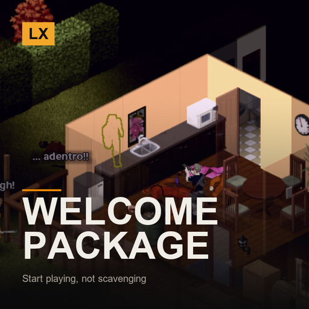

# LX Split-Screen Welcome Package

**A starter kit for every local character**

> For couch co-op runs where you want to start playing, not start scavenging.

`Project Zomboid B42.21+` · `v2.1.0` · `CC0`

[English](#english) · [Español](#español) · [Русский](#русский)

---

## English

This mod is part of the **LX Split-Screen Suite**, seven mods that make Project Zomboid B42 playable in 2–4 player couch co-op, with or without a gamepad. Each one stands alone — install only what you need.

### Why split-screen?

Split-screen is the mode that carries the most bugs in stable B42 — and the mods worth playing with, like Bandits and Project A-Life, are built for singleplayer and online multiplayer. Nobody is fixing couch co-op. This suite exists to close that gap: to make split-screen as playable as the modes that get the attention.

### Why gamepad?

B42 keeps improving controller support, but it is still rough, and the aim-and-shoot rework left gunplay on a gamepad close to unusable — you cannot even shoot a zombie lying on the ground. Split-screen *with* a gamepad is the worst case the game offers. These mods give PZ back an aim that was designed for a stick: assist on the vertical axis, B41-style lock-on, per-player aim state, and a lot more.

### What it does

- **One pack per local character** — An army ALICE pack, worn on the back, handed to each local player once — player 1, 2, 3 and 4 alike. Split-screen mods usually forget everyone but player 1; this one does not.
- **What is in it** — Shotgun and 4 boxes of shells, machete, crowbar, hammer, screwdriver, bolt cutters, blowtorch, welding mask, wood axe, saw, box of nails, rope, torch, a full canteen and 4 bandages.
- **Pick what you get** — Backpack, weapons, tools and survival are four separate switches. Turn the backpack off and the gear goes straight to your inventory; turn weapons off for a tools-only building run.
- **Careful about your stuff** — Anything that does not fit in the pack goes to the main inventory. If you are already wearing something on your back, the pack stays in your inventory instead — nothing you are wearing is ever replaced.
- **Does not duplicate** — Recorded in the character's own data: reloading a save never hands out a second one, and a character rebuilt from a save is recognised. A brand new character — after dying, say — gets a fresh one.

### Requirements

None. Vanilla B42.21 is enough.

### Installing

**From the Steam Workshop (recommended)**
Subscribe on the Workshop page. Steam downloads it; then start Project Zomboid, go to
**Mods** in the main menu and enable it. In split-screen, enabling it once covers all players.

**Manually**
1. Download this repository (green **Code** button -> **Download ZIP**) and unzip it.
2. Copy the folder `LX_SPLITSCREEN_WELCOME_PACKAGE` into your Zomboid mods folder:
   - Windows: `C:\Users\<you>\Zomboid\mods\`
   - Linux: `~/Zomboid/mods/`
   - macOS: `~/Library/Application Support/Zomboid/mods/`
   The result must be `...\Zomboid\mods\LX_SPLITSCREEN_WELCOME_PACKAGE\42\mod.info`.
3. Start the game, open **Mods** in the main menu and enable **LX Split-Screen Welcome Package**.

### Options

Options → MODS → **LX Split-Screen Welcome Package**. Master switch plus one toggle each for backpack, weapons, tools and survival.

### Notes

- This is a convenience mod — it is meant to skip the opening scavenge, not to be balanced.
- Delivered about 2 seconds after spawning, once the character has finished initialising.
- Works in normal singleplayer too; split-screen is just where it matters most.

### License

**CC0 1.0 Universal** — public domain dedication. Do whatever you want with it: copy it, change it, put it in a modpack, publish it, sell it. No permission needed, no credit required (though it is always welcome). See `LICENSE`.

### The rest of the suite

- [LX Coop Fixes](https://github.com/litoxperaloca/LX_CoopFixes) — Split-screen stability: vehicle crash, player 2 aiming, map stutter, error spam.
- [LX Split Aim](https://github.com/litoxperaloca/LX_SplitAim) — Controller aim assist and B41-style lock-on, per local player.
- [LX Split-Screen Quick Build](https://github.com/litoxperaloca/LX_SPLITSCREEN_CONTEXTMENU_BUILDING) — B41-style build menu in the context menu, because B42's window does not fit.
- [LX A-Life Split-Screen Fix](https://github.com/litoxperaloca/LX_ALifeSplit) — Project A-Life NPCs react to every local player, not just player 1.
- [LX Bandits Split-Screen Fix](https://github.com/litoxperaloca/LX_BanditsSplit) — Bandits target the right player, companions follow who recruited them.
- [LX Split-Screen Skills Boost](https://github.com/litoxperaloca/LX_SPLITSCREEN_SKILLS_IMPROVE) — A configurable skill floor per local character.
- [LX Theodore Split-Screen Fix](https://github.com/litoxperaloca/LX_TheodoreSplit) — Theodore, the family NPC, reacts to every local player and works with a gamepad.

---

## Español

> Para partidas de coop de sillón donde querés empezar a jugar, no a revolver casas.

Este mod es parte de la **LX Split-Screen Suite**, siete mods que hacen jugable Project Zomboid B42 en coop de sillón de 2 a 4 jugadores, con o sin mando. Cada uno funciona por separado — instalá solo lo que precises.

### ¿Por qué pantalla dividida?

Es la modalidad con más bugs en la B42 estable — y los mods que valen la pena, como Bandits y Project A-Life, están pensados para un jugador y multijugador online. Nadie arregla el coop de sillón. Esta suite existe para cerrar esa brecha: dejar la pantalla dividida a la par de las modalidades que sí reciben atención.

### ¿Por qué mando?

La B42 viene mejorando el soporte de mando, pero todavía deja mucho que desear, y el rework de apuntado y disparo dejó el tiroteo con mando casi imposible — ni siquiera podés dispararle a un zombi en el suelo. Pantalla dividida *con* mando es el peor escenario posible del juego. Estos mods le devuelven a PZ un apuntado pensado para stick: asistencia en el eje vertical, fijado de blanco estilo B41, estado de apuntado por jugador, y bastante más.

### Qué hace

- **Un paquete por personaje local** — Una mochila militar ALICE, puesta en la espalda, entregada una vez a cada jugador local — jugador 1, 2, 3 y 4 por igual. Los mods de pantalla dividida suelen olvidarse de todos menos del jugador 1; este no.
- **Qué trae** — Escopeta y 4 cajas de cartuchos, machete, palanqueta, martillo, destornillador, cortapernos, soplete, máscara de soldador, hacha de leñador, sierra, caja de clavos, cuerda, linterna, una cantimplora llena y 4 vendas.
- **Elegí qué recibís** — Mochila, armas, herramientas y supervivencia son cuatro interruptores separados. Apagá la mochila y el equipo va directo al inventario; apagá las armas para una partida de pura construcción.
- **Cuida tus cosas** — Lo que no entra en la mochila va al inventario principal. Si ya tenés algo puesto en la espalda, la mochila queda en el inventario — nunca se pisa nada de lo que tengas puesto.
- **No se duplica** — Queda registrado en los datos del propio personaje: recargar la partida nunca entrega un segundo, y un personaje reconstruido desde el guardado se reconoce. Un personaje nuevo — después de morir, por ejemplo — recibe uno nuevo.

### Requisitos

Ninguno. Alcanza con B42.21 vanilla.

### Instalación

**Desde el Steam Workshop (recomendado)**
Suscribite en la página del Workshop. Steam lo descarga solo; después abrí Project Zomboid,
andá a **Mods** en el menú principal y activalo. En pantalla dividida, con activarlo una vez
alcanza para todos los jugadores.

**A mano**
1. Descargá este repositorio (botón verde **Code** -> **Download ZIP**) y descomprimilo.
2. Copiá la carpeta `LX_SPLITSCREEN_WELCOME_PACKAGE` a tu carpeta de mods de Zomboid:
   - Windows: `C:\Users\<vos>\Zomboid\mods\`
   - Linux: `~/Zomboid/mods/`
   - macOS: `~/Library/Application Support/Zomboid/mods/`
   Tiene que quedar `...\Zomboid\mods\LX_SPLITSCREEN_WELCOME_PACKAGE\42\mod.info`.
3. Abrí el juego, entrá a **Mods** en el menú principal y activá **LX Split-Screen Welcome Package**.

### Opciones

Opciones → MODS → **LX Pantalla dividida: paquete de bienvenida**. Interruptor general más un toggle para mochila, armas, herramientas y supervivencia.

### Notas

- Es un mod de comodidad — está para saltearse el revoleo inicial, no para estar balanceado.
- Se entrega unos 2 segundos después de aparecer, cuando el personaje terminó de inicializarse.
- Funciona también en un jugador normal; la pantalla dividida es solo donde más se nota.

### Licencia

**CC0 1.0 Universal** — dedicado al dominio público. Hacé lo que quieras: copialo, cambialo, metélo en un modpack, publicalo, vendelo. No hace falta permiso ni crédito (aunque siempre se agradece). Ver `LICENSE`.

### El resto de la suite

- [LX Coop Fixes](https://github.com/litoxperaloca/LX_CoopFixes) — Estabilidad en pantalla dividida: crash de vehículos, apuntado del jugador 2, tirones del mapa, spam de errores.
- [LX Split Aim](https://github.com/litoxperaloca/LX_SplitAim) — Asistencia de apuntado con mando y fijado de blanco estilo B41, por jugador local.
- [LX Split-Screen Quick Build](https://github.com/litoxperaloca/LX_SPLITSCREEN_CONTEXTMENU_BUILDING) — Menú de construcción estilo B41 en el menú contextual, porque la ventana de B42 no entra.
- [LX A-Life Split-Screen Fix](https://github.com/litoxperaloca/LX_ALifeSplit) — Los NPCs de Project A-Life reaccionan a todos los jugadores locales, no solo al 1.
- [LX Bandits Split-Screen Fix](https://github.com/litoxperaloca/LX_BanditsSplit) — Los bandidos apuntan al jugador correcto, los compañeros siguen a quien los reclutó.
- [LX Split-Screen Skills Boost](https://github.com/litoxperaloca/LX_SPLITSCREEN_SKILLS_IMPROVE) — Un piso de habilidades configurable por personaje local.
- [LX Theodore Split-Screen Fix](https://github.com/litoxperaloca/LX_TheodoreSplit) — Theodore, el NPC familiar, reacciona a todos los jugadores locales y anda con mando.

---

## Русский

> Для совместной игры на диване, где хочется начать играть, а не начать собирать хлам.

Этот мод входит в набор **LX Split-Screen Suite** — семь модов, которые делают Project Zomboid B42 играбельным в совместной игре на диване для 2–4 человек, с геймпадом или без. Каждый работает сам по себе — ставьте только нужное.

### Почему разделённый экран?

Разделённый экран — режим с наибольшим числом ошибок в стабильной B42, а моды, ради которых стоит играть, вроде Bandits и Project A-Life, сделаны под одиночную игру и сетевой мультиплеер. Совместной игрой на диване не занимается никто. Этот набор существует, чтобы закрыть пробел: сделать разделённый экран таким же играбельным, как режимы, которым достаётся внимание.

### Почему геймпад?

B42 продолжает улучшать поддержку контроллеров, но она всё ещё сырая, а переработка прицеливания и стрельбы сделала перестрелки с геймпада почти невозможными — вы даже не можете выстрелить в зомби, лежащего на полу. Разделённый экран *вместе* с геймпадом — худший случай, который предлагает игра. Эти моды возвращают PZ прицеливание, рассчитанное на стик: помощь по вертикальной оси, захват цели в стиле B41, отдельное состояние прицеливания для каждого игрока и многое другое.

### Что делает

- **По набору на каждого локального персонажа** — Армейский рюкзак ALICE за спиной, выдаётся каждому локальному игроку один раз — первому, второму, третьему и четвёртому одинаково. Моды для разделённого экрана обычно забывают про всех, кроме первого; этот — нет.
- **Что внутри** — Дробовик и 4 коробки патронов, мачете, монтировка, молоток, отвёртка, болторез, газовая горелка, сварочная маска, колун, пила, коробка гвоздей, верёвка, фонарик, полная фляга и 4 бинта.
- **Выберите, что получите** — Рюкзак, оружие, инструменты и выживание — четыре отдельных переключателя. Отключите рюкзак, и снаряжение попадёт прямо в инвентарь; отключите оружие для чисто строительной партии.
- **Бережно относится к вашим вещам** — Всё, что не помещается в рюкзак, попадает в основной инвентарь. Если у вас уже что-то надето за спиной, рюкзак останется в инвентаре — надетые вещи никогда не заменяются.
- **Не дублируется** — Записывается в данные самого персонажа: перезагрузка сохранения не выдаёт второй набор, а персонаж, восстановленный из сохранения, распознаётся. Совсем новый персонаж — например, после смерти — получает новый.

### Требования

Нет. Достаточно обычной B42.21.

### Установка

**Из Steam Workshop (рекомендуется)**
Подпишитесь на странице Workshop. Steam скачает мод сам; затем запустите Project Zomboid,
откройте **Моды** в главном меню и включите его. При разделённом экране достаточно включить
один раз — это работает для всех игроков.

**Вручную**
1. Скачайте этот репозиторий (зелёная кнопка **Code** -> **Download ZIP**) и распакуйте.
2. Скопируйте папку `LX_SPLITSCREEN_WELCOME_PACKAGE` в папку модов Zomboid:
   - Windows: `C:\Users\<вы>\Zomboid\mods\`
   - Linux: `~/Zomboid/mods/`
   - macOS: `~/Library/Application Support/Zomboid/mods/`
   Должно получиться `...\Zomboid\mods\LX_SPLITSCREEN_WELCOME_PACKAGE\42\mod.info`.
3. Запустите игру, откройте **Моды** в главном меню и включите **LX Split-Screen Welcome Package**.

### Настройки

Настройки → МОДЫ → **LX Разделённый экран: стартовый набор**. Главный переключатель плюс по одному на рюкзак, оружие, инструменты и выживание.

### Примечания

- Это мод для удобства — он сделан, чтобы пропустить начальный сбор хлама, а не чтобы быть сбалансированным.
- Выдаётся примерно через 2 секунды после появления, когда персонаж закончил инициализацию.
- Работает и в обычной одиночной игре; при разделённом экране это просто заметнее всего.

### Лицензия

**CC0 1.0 Universal** — передано в общественное достояние. Делайте что угодно: копируйте, изменяйте, включайте в сборки модов, публикуйте, продавайте. Разрешение не требуется, указание авторства не обязательно (но всегда приятно). См. `LICENSE`.

### Остальные моды набора

- [LX Coop Fixes](https://github.com/litoxperaloca/LX_CoopFixes) — Стабильность разделённого экрана: вылет транспорта, прицеливание второго игрока, подтормаживания карты.
- [LX Split Aim](https://github.com/litoxperaloca/LX_SplitAim) — Помощь прицеливания с геймпада и захват цели в стиле B41 для каждого локального игрока.
- [LX Split-Screen Quick Build](https://github.com/litoxperaloca/LX_SPLITSCREEN_CONTEXTMENU_BUILDING) — Меню строительства в стиле B41 в контекстном меню, потому что окно B42 не помещается.
- [LX A-Life Split-Screen Fix](https://github.com/litoxperaloca/LX_ALifeSplit) — NPC из Project A-Life реагируют на всех локальных игроков, а не только на первого.
- [LX Bandits Split-Screen Fix](https://github.com/litoxperaloca/LX_BanditsSplit) — Бандиты целятся в нужного игрока, напарники следуют за тем, кто их нанял.
- [LX Split-Screen Skills Boost](https://github.com/litoxperaloca/LX_SPLITSCREEN_SKILLS_IMPROVE) — Настраиваемый минимальный уровень навыков для каждого локального персонажа.
- [LX Theodore Split-Screen Fix](https://github.com/litoxperaloca/LX_TheodoreSplit) — Theodore реагирует на всех локальных игроков и работает с геймпадом.

